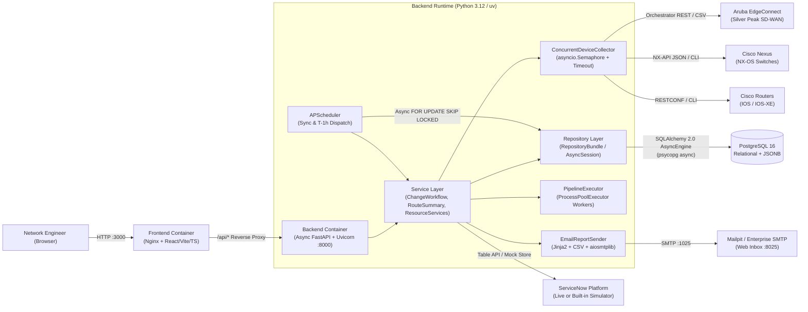
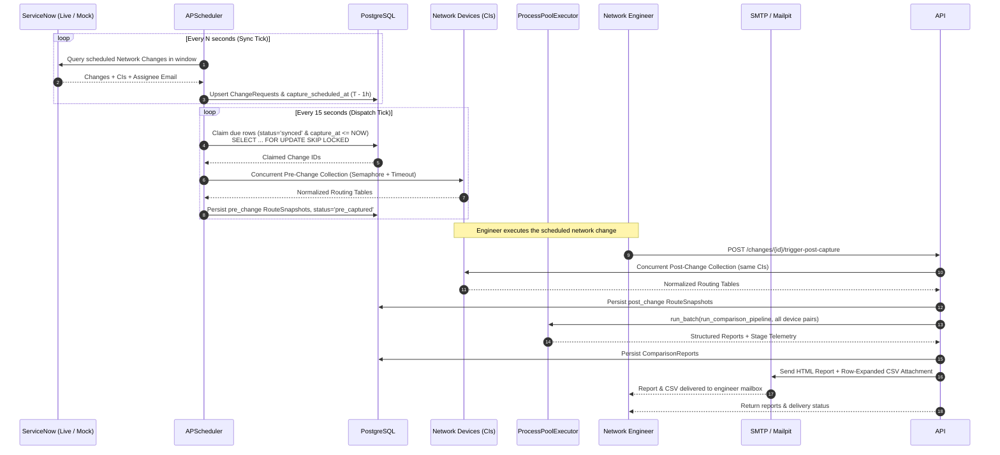
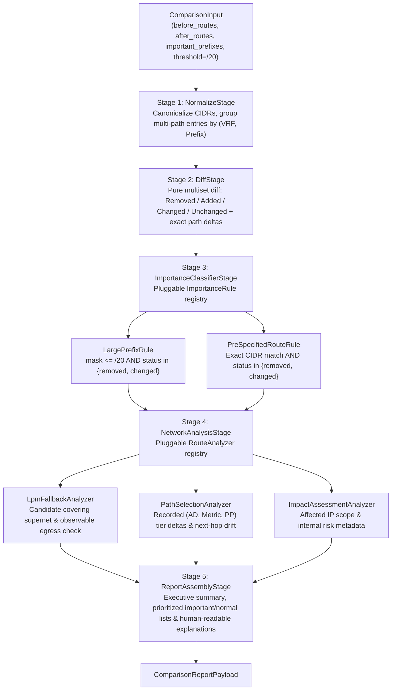
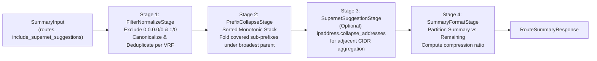
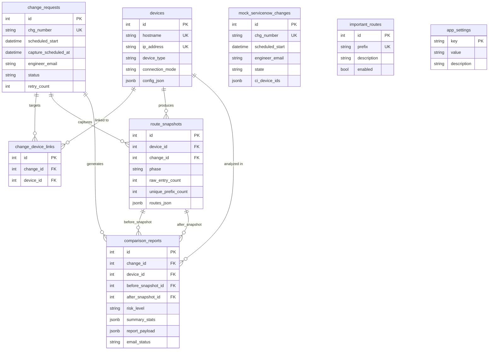

# NetRoute Guardian — System Architecture & Design Document

## 1. Executive Summary & Design Goals

**NetRoute Guardian** is an enterprise network operations platform that automates two high-value routing workflows:

1. **Feature 1 — ServiceNow-Integrated Routing Table Comparison & Analysis**:
   - Automatically synchronizes scheduled network Change Requests from ServiceNow within a configurable lookahead window.
   - Schedules and executes pre-change routing table collection **1 hour before** (`T - 1h`) the planned change start time across all associated network Configuration Items (CIs).
   - Provides an engineer-triggered post-change action that collects post-change routing tables from the exact same devices, executes a multi-stage comparison and evidence-based network analysis pipeline, and delivers a highlighted HTML comparison report with a row-expanded CSV attachment to the executing engineer's mailbox.
2. **Feature 2 — Multi-Vendor Route Summarization**:
   - Accepts a device hostname or IP address (Silver Peak / Aruba EdgeConnect, Cisco Nexus, or Cisco IOS/IOS-XE Router) or an uploaded routing table.
   - Excludes the default route (`0.0.0.0/0`), identifies existing summary routes covering more-specific prefixes, and separates them from remaining unsummarizable routes.

### Core Architectural Principles

| Principle | Implementation Strategy |
| :--- | :--- |
| **Strict Async 3-Layer Separation** | Directional **Async Route → Service → Repository** architecture backed by native SQLAlchemy 2.0 `AsyncEngine` / `AsyncSession` (`psycopg` async / `aiosqlite`). Automated tests in `backend/tests/test_architecture.py` enforce zero SQLAlchemy usage in routes/services, 100% `async def` API handlers, and zero synchronous `Session` usage. |
| **Pluggable External Adapters** | Abstract `ServiceNowProvider` and `DeviceCollector` interfaces decouple business workflows from external vendors. Production adapters and built-in demo simulators share the same parsers and downstream services. |
| **Single-Responsibility Pipelines** | Both comparison analysis and route summarization are decomposed into pure, composable `PipelineStage` units operating on typed context objects—easy to test, explain, and extend without modifying existing stages. |
| **Concurrency-First Execution** | I/O-bound device polling is bounded by `asyncio.Semaphore` with per-device timeouts and partial-failure isolation; CPU-bound prefix analysis runs in a `ProcessPoolExecutor` worker pool off the FastAPI event loop. |
| **State-Machine Driven Scheduling** | Dynamic `T - 1h` capture jobs are modeled explicitly in PostgreSQL and claimed atomically with `SELECT ... FOR UPDATE SKIP LOCKED`, making rescheduling, cancellation, idempotency, and UI visibility first-class citizens. |
| **Production-Parity Local Demo** | A 4-container Docker Compose stack (`frontend`, `backend`, `postgres`, `mailpit`) lets anyone exercise real PostgreSQL persistence, real vendor parsers, real multi-process pipelines, and real SMTP email delivery out of the box. |

---

## 2. System Context & Deployment Topology



### Container Services (`docker-compose.yml`)

| Service | Image / Build | Port(s) | Responsibility |
| :--- | :--- | :--- | :--- |
| `frontend` | `node:22-alpine` -> `nginx:1.27-alpine` | `3000 -> 80` | Serves compiled React SPA and reverse-proxies `/api/` and `/health` to `backend`. |
| `backend` | `python:3.12-slim` + `uv` | `8000` | Runs FastAPI REST API, APScheduler background jobs, and `ProcessPoolExecutor` workers. |
| `postgres` | `postgres:16-alpine` | `5432` | Stores relational change/CI/rule metadata and JSONB route snapshots & reports. |
| `mailpit` | `axllent/mailpit:v1.21` | `1025`, `8025` | Captures real SMTP emails sent by `backend` and exposes a browser inbox on `:8025`. |

---

## 3. Backend Layered Architecture

The backend (`backend/app/`) enforces strict directional **Async Route → Service → Repository** separation backed by native SQLAlchemy 2.0 **`AsyncEngine` / `AsyncSession`** (verified automatically via AST & runtime inspection tests in `backend/tests/test_architecture.py` so neither routes nor services can import SQLAlchemy, every API handler is `async def`, and all persistence runs asynchronously):

```text
app/
├── api/v1/router.py          # Async HTTP Route layer: validation, dependency injection, service delegation only
├── services/                 # Async business orchestration layer: workflows, concurrency fan-out, seed data (zero SQLAlchemy)
│   ├── change_service.py     # ServiceNow sync, T-1h pre-capture, post-capture + diff + CSV/email
│   ├── summary_service.py    # Device lookup (IP/hostname) & ad-hoc text/file summarization
│   ├── resource_services.py  # ImportantRouteService, DeviceService, SimulatorService, SettingsService
│   └── seed.py               # Idempotent initial demo inventory, critical routes & settings via async repositories
├── repositories/             # Async persistence layer: sole owner of AsyncSession queries, commits & row locking
│   ├── bundle.py             # Request-scoped async RepositoryBundle (Unit of Work) & get_repositories dependency
│   ├── change_repo.py        # Async ChangeRequest & CI links + FOR UPDATE SKIP LOCKED claiming
│   ├── device_repo.py        # Async network device inventory queries
│   ├── important_route_repo.py # Async pre-specified critical route CRUD
│   ├── snapshot_repo.py      # Async point-in-time RouteSnapshot persistence
│   ├── report_repo.py        # Async ComparisonReport persistence & email delivery status
│   ├── mock_snow_repo.py     # Async simulated ServiceNow ticket store
│   └── settings_repo.py      # Async runtime key-value AppSetting access
├── pipelines/                # Pure CPU-bound domain engines (100% picklable, zero DB/HTTP coupling)
│   ├── base.py               # PipelineStage[Ctx] ABC, PipelineRunner[Ctx], StageTrace telemetry
│   ├── comparison/           # Feature 1: 5-stage comparison & evidence-based analysis pipeline
│   └── summary/              # Feature 2: 4-stage monotonic-stack route summarization pipeline
├── adapters/                 # External integration boundaries (Swappable Live vs Mock)
│   ├── servicenow/           # ServiceNowProvider ABC -> RealServiceNowProvider / MockServiceNowProvider
│   ├── devices/              # DeviceCollector ABC -> EdgeConnect / CiscoNexus / CiscoRouter + real parsers
│   └── email/                # Jinja2 HTML template, row-expanded CSV exporter & async SMTP sender
├── scheduler/jobs.py         # APScheduler periodic async sync & due-job dispatch loop
├── models/entities.py        # SQLAlchemy 2.0 ORM schema
├── schemas/dto.py            # Pydantic v2 DTOs & CIDR/email validators
└── core/                     # Typed config, domain exceptions, AsyncEngine/AsyncSessionLocal factory, concurrency primitives
```

---

## 4. End-to-End Change Workflow (Feature 1)



### Handling Edge Cases in the Scheduling Lifecycle
- **Change Rescheduled**: When ServiceNow moves `scheduled_start` from `T` to `T'`, the next sync tick recalculates `capture_scheduled_at = T' - lead_minutes` automatically.
- **Change Cancelled**: When ServiceNow marks a ticket `cancelled`, any pending `synced` or `failed` job transitions to `cancelled` and will never fire.
- **Partial Device Failure**: If 1 out of 10 CIs times out or refuses SSH/REST during collection, the remaining 9 snapshots still succeed and are persisted while the failed device and exception reason are recorded cleanly on the change record.

---

## 5. Single-Responsibility Pipeline Architecture

Both core analytical engines inherit from `PipelineStage[Ctx]` and execute through `PipelineRunner[Ctx]` ([base.py](../backend/app/pipelines/base.py)), which automatically records per-stage execution duration (`duration_ms`) and structured diagnostics (`StageTrace`) returned to the UI.

### 5.1 Feature 1 — Comparison & Network Analysis Pipeline



#### Key Networking Semantics Implemented in Stage 4 (Evidence-Based Reporting)

1. **Recorded Preference & Path Summary (`PathSelectionAnalyzer`)**:
   - Compares recorded entries ordered by `(admin_distance, metric, peer_priority)` ascending, summarizes entry count changes (`before -> after`), and highlights per-interface recorded Next Hop changes (e.g., `twan0: 194.20.1.5 -> 194.20.1.1`).
   - **No speculative failover assertions**: Because static CSV exports do not include live device FIB active-route flags or SD-WAN Business Intent Overlay policies, the analyzer strictly states what changed in recorded `(AD, Metric, PP)` values and prompts the engineer to verify active route selection on the device (e.g., `10.127.0.0/16` lowest recorded `(AD, Metric, PP)` increased from `50 (AD:15)` to `150 (AD:15)`).
2. **Candidate Covering-Prefix Check (`LpmFallbackAnalyzer`)**:
   - For every removed non-default prefix, searches the post-change routing table in the same VRF (longest mask first) for the most-specific broader prefix:
     - **No covering supernet (`no_covering_supernet`)**: No broader non-default prefix exists in the post-change table (only `0.0.0.0/0` may match, if present).
     - **Broader prefix exists with blank egress (`covering_supernet_egress_unknown`)**: When Next Hop and Interface are blank (such as SD-WAN CSV exports omitting tunnel/peer IDs), explicitly states that actual traffic takeover and egress cannot be confirmed from the CSV alone and must be verified on the device.
     - **Broader prefix exists with explicit egress**: Compares the recorded Next Hop/Interface and labels `covering_supernet_same_next_hop` or `covering_supernet_different_next_hop`, while still advising verification of live forwarding policy.

#### Extensibility
- To add a new priority criterion (e.g., flag BGP AS-path prepending or specific VRF changes), implement a subclass of `ImportanceRule` and register it in `build_comparison_pipeline()`.
- To add a new network diagnostic (e.g., blackhole Null0 detection or ECMP imbalance detection), implement a subclass of `RouteAnalyzer` and append it to `NetworkAnalysisStage`.

---

### 5.2 Feature 2 — Route Summarization Pipeline



#### Algorithm Choice: Sorted Monotonic Stack vs. Binary Prefix Trie
- Prefixes within each `(vrf, ip_version)` partition are sorted by `(int(network_address) ASC, prefixlen ASC)`.
- Because a covering supernet always has a smaller-or-equal `network_address` and strictly smaller `prefixlen` than every subnet it covers, all covered descendants appear contiguously immediately after their parent.
- A single pass with a monotonic stack (`while stack and not net.subnet_of(stack[-1]): stack.pop()`) folds every covered prefix directly beneath its top-level covering route `stack[0]`.
- **Practical Advantages**:
  - In CPython, avoids per-bit object node allocation overhead compared to a hand-written Binary Trie, naturally produces IP-ascending output, and supports both IPv4 and IPv6 identically.
  - On the provided `subnetsExample_afterChange.csv` (4,411 raw rows -> 1,765 unique non-default prefixes), the pipeline completes in milliseconds and reduces the table to **175 output routes** (**27 summary routes** covering 1,590 more-specific routes + **148 remaining routes**, **90.1% reduction**).

---

## 6. Multi-Vendor Device Abstraction & Normalized Route Model

All vendor collectors separate **Transport** (live network protocol vs. simulated payload) from **Parsing** (always executed by production parsers) and emit a unified `NormalizedRoute` record:

```python
@dataclass(frozen=True)
class NormalizedRoute:
    prefix: str                  # Canonical CIDR (e.g. "10.127.0.0/16")
    vrf: str = "default"         # VRF or SD-WAN Segment isolation domain
    next_hop: str = ""           # Next-hop IP (blank for SD-WAN overlay paths)
    interface: str = ""          # Outgoing interface (e.g. "lan0", "Eth1/1", "Gi0/0/0")
    protocol: str = "unknown"    # bgp | ospf | static | connected | unknown (never inferred when omitted)
    admin_distance: int | None   # Administrative Distance (e.g. 1, 15, 20, 110, 251)
    metric: int | None           # Route metric / cost
    peer_priority: int | None    # EdgeConnect SD-WAN Peer Priority (PP)
    raw_metric: str = ""         # Original vendor string preserved for UI/email fidelity
    appliance: str = ""          # Source device hostname
```

| Device Type | Live Production Transport | Production Parser Module | Demo Mode Behavior |
| :--- | :--- | :--- | :--- |
| **Silver Peak / Aruba EdgeConnect** | Aruba Orchestrator REST API (`/gms/rest/subnets/appliance/{nePk}`) | `parse_edgeconnect_csv` (UTF-8 BOM + `AD/PP` regex) & `parse_edgeconnect_orchestrator_json` | Reads `beforeChange.csv` / `afterChange.csv` via worker thread |
| **Cisco Nexus (NX-OS)** | NX-API JSON-RPC (`show ip route vrf all \| json`) | `parse_cisco_nxapi_json` & `parse_cisco_nxos_cli` | Feeds realistic raw NX-OS CLI output into `parse_cisco_nxos_cli` |
| **Cisco Router (IOS / IOS-XE)** | RESTCONF (`ietf-routing:routing-state`) | `parse_cisco_ios_cli` (handles multi-line ECMP continuation) | Feeds realistic raw IOS-XE CLI output into `parse_cisco_ios_cli` |

---

## 7. Concurrency & Scalability Architecture

The platform separates concurrency strategies by workload type so neither slow devices nor large routing tables can starve the API server:

### 7.1 I/O-Bound Device Collection Concurrency
- **Bounded Fan-Out**: `ConcurrentDeviceCollector.collect_many()` wraps each device fetch in an `asyncio.Semaphore(MAX_CONCURRENT_DEVICE_COLLECTIONS)` (default `10`) and `asyncio.wait_for(..., timeout=DEVICE_COLLECTION_TIMEOUT_SECONDS)` (default `30s`).
- **Partial-Failure Isolation**: `asyncio.gather(..., return_exceptions=True)` guarantees one unreachable router never aborts collection for sibling devices in the same Change Request.
- **Non-Blocking Parsing**: Large CSV reads and regex CLI parsers are dispatched with `asyncio.to_thread()` to keep the asyncio event loop responsive.

### 7.2 CPU-Bound Pipeline Parallelism
- **Multi-Process Execution**: `PipelineExecutor` runs `run_comparison_pipeline` and `run_summary_pipeline` inside a `ProcessPoolExecutor(max_workers=PIPELINE_MAX_WORKERS)` (default `4`), bypassing Python's GIL for multi-core parallelism when comparing many large BGP/SD-WAN routing tables simultaneously via `run_batch()`.
- **Clean Picklable Boundary**: Pipeline entrypoints accept and return pure dataclasses / built-in dicts only—no SQLAlchemy sessions or FastAPI objects cross process boundaries.
- **Configurable Modes**: Supports `process` (production default), `thread`, and `sync` (deterministic fast unit tests).

### 7.3 Horizontal Scale-Out Path
- Today's PostgreSQL `FOR UPDATE SKIP LOCKED` job claiming already supports running multiple backend replicas safely without double-collecting the same Change Request.
- If fleet scale grows to thousands of devices per change window, the `PipelineExecutor` and `ConcurrentDeviceCollector` abstractions can swap to a distributed Celery/Taskiq + Redis worker tier without modifying any pipeline, parser, or API contract.

---

## 8. Database Schema Design (PostgreSQL)

The schema uses a **hybrid Relational + JSONB** approach: strict relational foreign keys and unique constraints protect workflow state and rules, while JSONB stores bulk route snapshots (4,000–50,000 entries per capture) and rich report payloads efficiently in a single transactional write.



---

## 9. Frontend Architecture (React + Vite + TypeScript)

- **Stack**: React 18, Vite 6, TypeScript (strict mode), React Router v6, Tailwind CSS, Lucide icons.
- **API Integration**: Centralized typed client in [client.ts](../frontend/src/api/client.ts) talking to `/api/v1` (proxied by Vite in dev and Nginx in Docker).
- **Views & Responsibilities**:
  1. **Change Tracking (`/`)**: ServiceNow change KPI dashboard, countdown to `T - 1h` auto-capture, one-click sync/dispatch and pre/post-capture triggers.
  2. **Change Detail (`/changes/:id`)**: 4-step workflow progress bar, per-device `ReportViewer` instances with prominent `IMPORTANT` row highlighting (without subjective `Severity` columns/filters), multi-criteria filtering (`Change Type`, `Matched Rule`, `VRF`, search), color-coded prefixes & entry deltas (red removed, green added, amber changed), expandable path-level color diffs (`[-]` red removed, `[+]` green added, `[=]` muted unchanged), row-expanded CSV export (`Export CSV` / `Export Filtered CSV`), pipeline stage telemetry inspection, and modal HTML email preview/resend.
  3. **Ad-hoc Compare (`/adhoc-compare`)**: Drag-and-drop CSV/CLI comparison plus one-click sample CSV demonstration using the shared `ReportViewer`.
  4. **Route Summary (`/route-summary`)**: Unified Feature 2 workbench supporting device lookup by IP/hostname, raw text/CLI paste, or CSV upload, expandable summary-to-subnet mapping, optional adjacent supernet suggestions, and CSV export.
  5. **Important Routes (`/important-routes`)**: Full CRUD for pre-specified critical prefixes and configurable mask threshold (`<= /20`).
  6. **ServiceNow & Devices (`/simulator`)**: Sandbox UI to create/reschedule/fast-forward simulated ServiceNow changes and inspect multi-vendor device inventory and concurrency runtime parameters.

---

## 10. Quality Assurance, Security & Production Hardening

### Verification & Test Coverage
- **Backend (`uv run pytest`)**: 35 automated tests covering vendor parsers (EdgeConnect CSV/JSON, NX-OS CLI/NX-API, IOS-XE CLI), all 5 Feature 1 comparison stages, exact-match critical rule isolation, evidence-based covering-prefix diagnostics, Feature 2 monotonic-stack summarization (both mini-example and 4,411-row CSV), bounded `asyncio.Semaphore` failure isolation, real `ProcessPoolExecutor` multi-process batching, scheduler `T - 1h` dynamic rescheduling/cancellation, Jinja2 HTML email rendering & row-expanded CSV attachments, async Repository unit tests, AST & runtime architectural boundary enforcement (zero SQLAlchemy in routes/services, 100% async routes, and fully async `AsyncEngine` / `AsyncSession` database & repositories), completed change deletion with artifact cleanup, and end-to-end REST API integration.
- **Frontend (`npm test`)**: 11 Vitest + React Testing Library component and interaction suites covering `Layout` (viewport-pinned collapsible icon-rail sidebar independent of main content scroll), `ReportViewer` (filtering, `IMPORTANT` highlighting, color-coded removed/added/unchanged path-entry diffs, row-expanded CSV export), `RouteSummaryPage`, `ImportantRoutesPage`, `ChangesPage` (including completed change request deletion with confirmation modal), and `SimulatorPage`, plus strict `tsc -b` typechecking.

### Production Deployment Checklist
1. **Least-Privilege Credentials**: Use read-only API tokens/accounts for ServiceNow (`change_request`, `task_ci`, `sys_user`) and network devices (`show ip route` / read-only Orchestrator role); inject secrets via Vault/Kubernetes Secrets rather than `.env` files.
2. **Transport Security**: Enable TLS (`verify_ssl=True`) for Orchestrator, NX-API, RESTCONF, ServiceNow, and SMTP (`SMTP_USE_TLS=true`), and terminate HTTPS in front of Nginx.
3. **Authentication & RBAC**: Protect REST endpoints with enterprise SSO / OIDC (e.g., OAuth2 JWT middleware on FastAPI) and restrict Important Route rule edits and post-change triggers to authorized NetOps roles.
4. **Data Privacy**: Keep sensitive customer route exports out of Git via `.gitignore` (`requirements/`, `backend/sample_data/*.csv`) and enforce snapshot retention policies in PostgreSQL.
