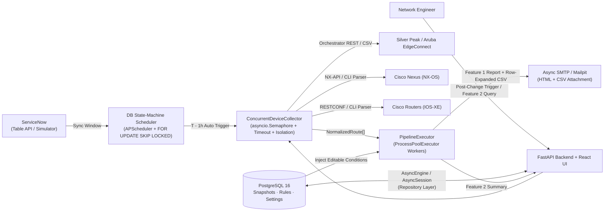
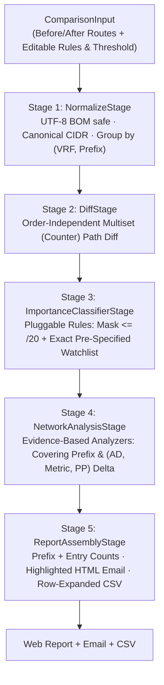
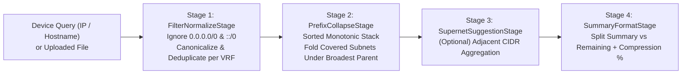

# NetRoute Guardian — Solution Design Proposal

> **Purpose**: Concise architecture and algorithm design response for the *Routing Table Comparison & Analysis (Feature 1)* and *Route Summarization (Feature 2)* open question.  
> **Core Thesis**: Treat routing-table analysis as **stateless, single-responsibility pipelines** decoupled from external device/ITSM adapters, ensuring **zero missed diffs**, **evidence-based diagnostics (no guesswork)**, **runtime-editable rules**, and **multi-core scalability**.

---

## 1. End-to-End Architecture & Operational Governance

To meet enterprise reliability requirements while remaining 100% demonstrable out of the box (`docker compose up`), the platform separates **control-plane orchestration**, **pluggable external adapters**, and **pure CPU-bound analysis pipelines**:



### Why This Solves Real-World Operational Challenges
1. **Strict Async Route → Service → Repository Layering & Native Async DB**: Every FastAPI route is `async def` and delegates strictly to Services, which delegate all persistence to Repositories (`RepositoryBundle`) running on native SQLAlchemy 2.0 **`AsyncEngine` / `AsyncSession`** (`psycopg` async for PostgreSQL, `aiosqlite` for SQLite) so database I/O never blocks the event loop. Automated tests in `backend/tests/test_architecture.py` enforce zero SQLAlchemy usage in routes/services, 100% async route handlers, and zero synchronous `Session` usage.
2. **Reliable `T - 1h` Scheduling**: Instead of fragile in-memory timers, `capture_scheduled_at = scheduled_start - 1h` is stored in PostgreSQL. If a ServiceNow ticket is **rescheduled** or **cancelled**, the next sync tick updates or cancels the job cleanly. Claiming due jobs via `SELECT ... FOR UPDATE SKIP LOCKED` prevents duplicate collection across multiple backend replicas.
3. **Bounded Concurrency & Fault Isolation**: Multi-CI changes poll devices concurrently via `asyncio.Semaphore` with per-device timeouts (`asyncio.wait_for`) and `return_exceptions=True`. One unreachable router never blocks or aborts sibling devices.
4. **True Multi-Core Pipeline Execution**: Both analytical pipelines accept and return pure, picklable dataclasses (zero DB/HTTP coupling) and fan out across a `ProcessPoolExecutor`, avoiding Python GIL contention on large routing tables.
5. **Multi-Vendor Parity**: Transport (REST / NX-API / RESTCONF / Mock) is strictly separated from **production parsers** (`parse_edgeconnect_csv`, `parse_cisco_nxos_cli`, `parse_cisco_ios_cli`), normalizing all vendors into one canonical `NormalizedRoute` model.

---

## 2. Feature 1: Stage-Governed Comparison & Analysis Pipeline

Rather than writing a monolithic diff script, Feature 1 is governed by **5 single-responsibility stages** wrapped by `PipelineRunner` (which records per-stage execution telemetry and timing):



### Key Real-World Edge Cases Addressed

#### A. Zero Missed Diffs on Multi-Path / ECMP / SD-WAN Overlay Routes (`Stage 1 + Stage 2`)
- **Problem**: A single prefix frequently has multiple rows (ECMP or SD-WAN tunnels), sometimes with **identical** attributes (e.g., three `40 (AD:15)` overlay rows). A naive line diff triggers false positives whenever row ordering shifts; a naive `set()` deduplication **silently misses** tunnel redundancy drops (e.g., 3 tunnels dropping to 2).
- **Solution**: `NormalizeStage` canonicalizes every prefix (`strict=False`, clearing host bits) and groups paths by `(vrf, prefix)`—isolating VRFs on Cisco devices. `DiffStage` then computes exact **multiset (`collections.Counter`)** differences on immutable path signatures:
  - `removed_paths = before_counter - after_counter`
  - `added_paths = after_counter - before_counter`
  - `unchanged_path_count = sum((before_counter & after_counter).values())`
- **Verified Accounting on Reference Sample CSV (`uec-abc-prd01`)**:
  - **Prefix granularity**: `1,775` before − `10` removed + `1` added = `1,766` after (net `−9`), plus `3` changed prefixes (`14` total prefix diffs).
  - **Entry (row) granularity**: `4,442` before − `40` removed entries (`32` from removed prefixes + `8` from changed prefixes) + `9` added entries (`3` from added prefix + `6` from changed prefixes) = `4,411` after (net `−31`). Every single row reconciles with zero loss.

#### B. Strict, Transparent Importance Classification (`Stage 3`)
Each `ImportanceRule` is an independent, unit-testable strategy class:
1. **`LargePrefixRule`**: Flags `removed` or `changed` prefixes where `prefix_len <= threshold` (default `/20`, runtime-editable).
2. **`PreSpecifiedRouteRule`**: **Exact canonical CIDR set lookup** against the user-editable watchlist (`0.0.0.0/0`, `10.76.12.0/23`, `10.127.0.0/16`, `10.130.0.0/17`, etc.).
- Multi-rule hits are accumulated transparently (e.g., `10.127.0.0/16` displays both triggers). In the Web UI and HTML email, important entries are prominently highlighted without arbitrary subjective severity labels.

#### C. Evidence-Based Network Analysis — No Speculation (`Stage 4`)
A common pitfall in automated network tools is over-claiming live forwarding behavior from static table exports. Our analyzers strictly report **observable facts** and flag unverifiable conditions honestly:
- **Candidate Covering-Prefix Check (`LpmFallbackAnalyzer`)**:
  - Scans active post-change prefixes (same VRF, longest mask first) for a broader covering prefix.
  - **Crucial safeguard**: On EdgeConnect CSV exports, SD-WAN overlay rows leave `Next Hop` and `Interface` blank. Comparing two blank strings as "matching egress" would create **false reassurance**. Our analyzer explicitly checks `_has_explicit_egress()`: when egress is blank (e.g., removed `10.76.12.0/23` under broader `10.64.0.0/12`), it reports `covering_supernet_egress_unknown` and instructs the engineer to verify active RIB/FIB and routing policy on the device.
  - When no non-default covering prefix exists (e.g., `10.132.0.0/14`, `10.121.0.0/16`, `10.130.128.0/17`), it reports `no_covering_supernet` (only `0.0.0.0/0` may match, if present).
- **Recorded `(AD, Metric, PP)` & Next-Hop Delta Summary (`PathSelectionAnalyzer`)**:
  - Parses EdgeConnect `"50 (AD:15, PP:7)"` and Cisco `[20/100]` into structured `(admin_distance, metric, peer_priority)`.
  - Rather than asserting live failover (which depends on device FIB & SD-WAN Business Intent Overlays), it objectively reports what changed: e.g., on `10.127.0.0/16`, the lowest recorded `(AD, Metric, PP)` increased from `50 (AD:15)` to `150 (AD:15)` (`-2 / +2 entries`); on `10.130.0.0/17`, entry count dropped `4 -> 2`; on `0.0.0.0/0`, explicit Next Hop changes occurred on `twan0` (`194.20.1.5 -> 194.20.1.1`) and `lan0` (`10.162.183.217 -> 10.162.183.230`).

#### D. Dual-Granularity Reporting (`Stage 5`)
- **Web UI & HTML Email**: Summarizes at prefix level *and* displays per-prefix entry deltas (e.g., `4 -> 0 (-4 entries)`), with multi-criteria filtering (`Change Type`, `Matched Rule`, `VRF`, search), prominent `IMPORTANT` row highlighting, and semantic color-coding throughout (removed prefixes/entries in **red**, added in **green**, changed prefixes in **amber**, plus expanded per-path diffs tagging `[-]` removed, `[+]` added, and `[=]` unchanged paths via exact multiset matching).
- **CSV Export & Email Attachment**: Automatically expands diffs to **1 row per changed/removed/added route entry** (`49` diff rows for the sample dataset) across a clean 19-column schema—with the first 5 columns (`Appliance, Subnet/Mask, Next Hop, Interface, Metric`) matching the raw EdgeConnect export 1:1, `Severity` / `Affected_IPs` / `Fallback_Status` / `Fallback_Parent` omitted from CSV output, and `VRF, Protocol` placed last.

---

## 3. Feature 2: Stage-Governed Route Summarization Pipeline



### Algorithm Deep Dive: Sorted Monotonic Stack
Within each `(vrf, ip_version)` partition, `PrefixCollapseStage` sorts unique networks by `(int(network_address) ASC, prefixlen ASC)` and runs a single linear pass using an ancestor stack:

```python
for net in sorted(networks, key=lambda n: (int(n.network_address), n.prefixlen)):
    while stack and not net.subnet_of(stack[-1][0]):
        stack.pop()
    if stack:
        stack[0][1].covered_routes.append(str(net))   # Fold under broadest covering parent
        stack.append((net, stack[0][1]))
    else:
        node = CollapsedRouteNode(vrf=vrf, prefix=str(net), prefix_len=net.prefixlen)
        collapsed_nodes.append(node)
        stack.append((net, node))
```

### Why This Algorithm Is Optimal in Practice
- **Exact Correctness (Laminar Interval Invariant)**: Any covering supernet $A \supset B$ always has $\text{start}(A) \le \text{start}(B)$ and $\text{prefixlen}(A) < \text{prefixlen}(B)$, so $A$ is guaranteed to appear immediately before all of its descendants. Multi-level hierarchies (e.g., `10.48.0.0/13` $\supset$ `10.54.0.0/16` $\supset$ `10.54.0.0/22`) fold accurately under the broadest existing prefix `stack[0]`.
- **Faster & Leaner Than a Hand-Written Binary Trie in Python**: Avoids allocating per-bit heap node objects per prefix, leverages C-optimized Timsort, naturally produces IP-ascending output, and handles **both IPv4 and IPv6** without code changes. Each prefix is pushed and popped from the stack at most once in a single pass after sorting.
- **Verified Results**:
  - **Requirement Mini-Example** (`7` routes + `0.0.0.0/0`): Outputs `10.1.0.0/16`, `10.2.2.0/26`, `172.16.2.0/24`, `192.168.8.0/26` (2 summary routes + 2 remaining) — **100% exact match**.
  - **Reference `subnetsExample_afterChange.csv`** (`4,411` rows, `15` default routes ignored, `1,765` unique non-default prefixes): Reduces to **`175` output routes** (**`27` summary routes** covering `1,590` specific subnets + **`148` remaining routes**, **90.1% reduction**) in milliseconds.

---

## 4. Extensibility & Runtime Configurability

Because every business condition is injected at execution time and every analytical step sits behind a clean abstract base class, the system scales across evolving NetOps policies with minimal code changes:

| Extension Point | How to Customize / Extend | Impact on Existing Stages |
| :--- | :--- | :--- |
| **Pre-Specified Critical Routes** | Edit live via UI or `POST/PUT/DELETE /api/v1/important-routes` (takes effect on next run) | Zero code change |
| **Broad Subnet Threshold (`<= /20`)** | Edit live via UI or `PUT /api/v1/settings` (`large_prefix_threshold`) | Zero code change |
| **New Priority Rule** (e.g., flag added `/16` route leaks) | Subclass `ImportanceRule` & register in `ImportanceClassifierStage` | Zero change to Diff / Analyzers / Report |
| **New Network Diagnostic** (e.g., `Null0` blackhole or AS-path prepending check) | Subclass `RouteAnalyzer` & append to `NetworkAnalysisStage` | Findings flow automatically into UI, HTML email & CSV |
| **New Vendor / Protocol** (e.g., Juniper Junos, Arista EOS) | Implement `DeviceCollector` + parser returning `NormalizedRoute[]` | 100% reuse of both pipelines, scheduler, email & UI |

---

## 5. Verification Summary

All core guarantees are backed by automated test suites (`uv run pytest` and `npm test`):
- **Backend (35 `pytest` cases, `ruff` 0 errors)**: Covers EdgeConnect CSV/JSON, Cisco NX-OS & IOS-XE parsers, exact prefix & entry conservation on the provided 4,442-row CSVs, exact-match watchlist isolation, `covering_supernet_egress_unknown` safeguard, Feature 2 mini-example & 1,765-prefix summarization, `asyncio.Semaphore` concurrency + timeout fault isolation, real `ProcessPoolExecutor` parallel batches, `T - 1h` scheduler rescheduling/cancellation, HTML email + row-expanded CSV attachments, async Repository unit tests, AST & runtime architectural enforcement (zero SQLAlchemy in routes/services, 100% async routes, fully async `AsyncEngine` / `AsyncSession` database & repositories), completed change deletion, and full REST API integration.
- **Frontend (11 `Vitest` + RTL cases, strict `tsc -b` build)**: Covers viewport-locked collapsible sidebar layout, Change Tracking completed-request deletion, interactive filtering, `IMPORTANT` highlighting, color-coded removed/added/unchanged route-entry diffs, row-expanded CSV export, Feature 2 device lookup & covered-subnet expansion, Important Routes CRUD, and ServiceNow Simulator flows.
