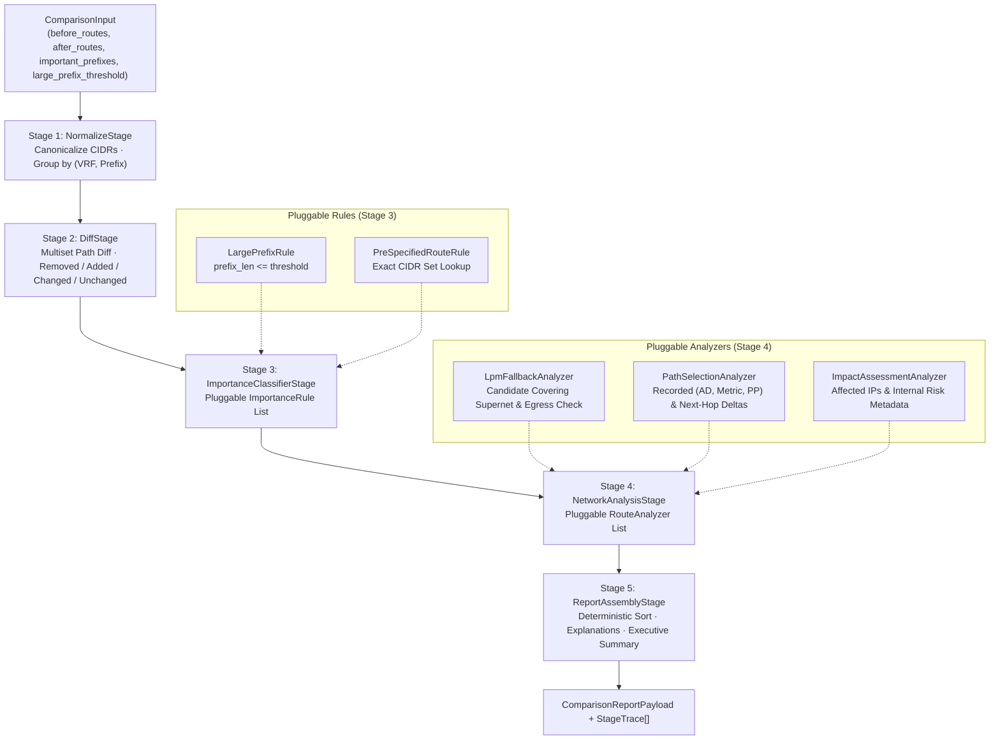
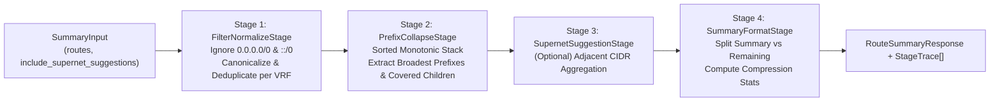

# Pipeline Design, Algorithms, Extensibility & Configurable Conditions

This document details the internal design of NetRoute Guardian's two single-responsibility processing pipelines:

1. **Feature 1 — Routing Table Comparison & Network Analysis Pipeline** (`backend/app/pipelines/comparison/`)
2. **Feature 2 — Route Summarization Pipeline** (`backend/app/pipelines/summary/`)

It covers the core pipeline framework, exact algorithms and implementation details, runtime-editable conditions, and concrete extension patterns for adding new rules, analyzers, or stages.

---

## 1. Design Philosophy: Why a Single-Responsibility Pipeline?

Monolithic route-diff functions quickly become tangled—mixing CIDR parsing, set comparison, alert thresholds, networking heuristics, and report formatting into code that is hard to test, reason about, or extend.

NetRoute Guardian models both engines as **stateless, composable, single-responsibility pipelines** built on three core primitives in [base.py](../backend/app/pipelines/base.py):

- **`PipelineStage[Ctx]` (Abstract Base Class)**: Encapsulates exactly one transformation or analytical step (`name`, `description`, `execute(ctx) -> dict | None`).
- **`PipelineRunner[Ctx]`**: Executes an ordered list of stages sequentially on a typed context object and records a **`StageTrace`** (`name`, `description`, `duration_ms`, `details`) for every stage—giving full observability in both API responses and the Web UI.
- **Pure Picklable Boundary (`ComparisonInput` / `SummaryInput`)**: Pipelines have **zero** dependencies on SQLAlchemy sessions, FastAPI requests, or network sockets. Every input, context, and output is a plain dataclass or JSON-serializable `dict`, allowing seamless offloading to **`ProcessPoolExecutor`** workers for true multi-core parallelism across large BGP/SD-WAN routing tables.

---

## 2. Feature 1: Comparison & Network Analysis Pipeline

### 2.1 Pipeline Topology



---

### 2.2 Stage-by-Stage Implementation & Algorithms

#### Stage 1: `NormalizeStage` ([stages.py](../backend/app/pipelines/comparison/stages.py))
- **Single Responsibility**: Clean raw normalized route dicts into canonical `(vrf, prefix) -> list[RoutePath]` maps for both `before` and `after` snapshots.
- **Details**:
  - Canonicalizes every prefix via `ipaddress.ip_network(raw, strict=False)` so host-bit artifacts (e.g. `10.127.0.1/16`) normalize to `10.127.0.0/16`.
  - Isolates routing tables by `vrf` (defaulting to `"default"`), preventing cross-VRF collisions on Cisco Nexus / IOS-XE / EdgeConnect Segment tables.
  - Wraps each path in a frozen `RoutePath` dataclass exposing:
    - `signature()`: 7-tuple `(next_hop, interface, protocol, admin_distance, metric, peer_priority, raw_metric)` for exact multiset equality.
    - `preference_key()`: 3-tuple `(AD, Metric, PP)` with sentinel fallbacks `(999, 999_999_999, 999)` for lexicographic route preference comparison.

#### Stage 2: `DiffStage` ([stages.py](../backend/app/pipelines/comparison/stages.py))
- **Single Responsibility**: Compute purely objective differences without embedding any alerting thresholds or networking opinions.
- **Algorithm**:
  1. Partition keys `(vrf, prefix)` into `removed_keys = B - A`, `added_keys = A - B`, and `common_keys = B & A`.
  2. For each key in `common_keys`, build `collections.Counter` multisets over `RoutePath.signature()`:
     - If `Counter(before) == Counter(after)`, increment `unchanged_prefix_count`.
     - Otherwise emit a `changed` `RouteDiffEntry` with exact `removed_paths = before_counter - after_counter`, `added_paths = after_counter - before_counter`, and `unchanged_path_count = sum((before_counter & after_counter).values())`.
  3. Why **multiset (`Counter`)** instead of `set`? Real SD-WAN tables (such as `uec-abc-prd01`) frequently contain multiple identical overlay rows (e.g., three `40 (AD:15)` paths representing 3 equal-cost SD-WAN tunnels). Using `Counter` accurately detects when tunnel redundancy drops from `3` to `2` or `4` to `2`.
  4. Sort all resulting `diff_entries` deterministically by `(vrf, int(network_address), prefix_len)`.

#### Stage 3: `ImportanceClassifierStage` ([rules.py](../backend/app/pipelines/comparison/rules.py))
- **Single Responsibility**: Evaluate pluggable `ImportanceRule` instances against every `RouteDiffEntry` and record every matched rule ID and human-readable reason.
- **Built-in Rules**:
  1. **`LargePrefixRule(max_prefix_len)`**:
     - Triggers when `entry.change_type in ("removed", "changed")` **and** `entry.prefix_len <= max_prefix_len` (default `/20`).
  2. **`PreSpecifiedRouteRule(prefixes)`**:
     - Pre-canonicalizes user-configured critical routes into a Python `set[str]` for **direct exact hash-set lookup**.
     - Triggers when `entry.change_type in ("removed", "changed")` **and** `entry.prefix in self._prefixes`.
     - Intentionally **exact-match only** (no implicit subnet inheritance) to keep alerting semantics predictable and free of false positives.
- **Multi-rule transparency**: An entry like `10.127.0.0/16` (changed) or `0.0.0.0/0` (changed) matches **both** rules; both rule IDs and reasons are preserved and displayed as distinct pills in the UI and HTML email.

#### Stage 4: `NetworkAnalysisStage` ([analyzers.py](../backend/app/pipelines/comparison/analyzers.py))
- **Single Responsibility**: Run pluggable `RouteAnalyzer` modules to enrich raw diffs with **strictly evidence-based** network observations (no speculative claims about live device forwarding when active FIB flags or SD-WAN tunnel IDs are absent from the snapshot).
- **Built-in Analyzers**:
  1. **`LpmFallbackAnalyzer` (for `removed` routes)**:
     - Indexes all active non-default (`prefixlen > 0`) post-change prefixes grouped by `vrf`, sorted by `prefixlen` **descending** (longest mask first).
     - For each removed prefix `R`, scans `after_by_vrf[R.vrf]` for the first network `P` where `P.version == R.version`, `P.prefixlen < R.prefixlen`, and `R.subnet_of(P)` — finding the most-specific candidate covering supernet.
     - Categorizes strictly by observable fields:
       - No `P` found (or `R` itself is `0.0.0.0/0`) $\rightarrow$ `fallback_status = "no_covering_supernet"`.
       - `P` found, but Next Hop and Interface are blank on either side (e.g. SD-WAN CSV exports without tunnel metadata) $\rightarrow$ `fallback_status = "covering_supernet_egress_unknown"` (explicitly notes that actual traffic takeover and egress cannot be confirmed from CSV alone).
       - `P` found and both sides have explicit Next Hop/Interface $\rightarrow$ compares recorded egress and labels `covering_supernet_same_next_hop` or `covering_supernet_different_next_hop`.
  2. **`PathSelectionAnalyzer` (for `changed` routes)**:
     - Compares the lowest recorded `(AD, Metric, PP)` tier before and after, summarizes exact entry count deltas (`before -> after`), and lists per-interface recorded Next Hop changes (e.g. `twan0: 194.20.1.5 -> 194.20.1.1`).
     - Reports observable changes objectively (e.g. *"Lowest recorded (AD, Metric, PP) entry increased from 50 (AD:15) to 150 (AD:15)"*) and instructs the engineer to verify active route selection / policy routing on the device rather than assuming failover.
  3. **`ImpactAssessmentAnalyzer` (global severity & IP scope)**:
     - Computes `affected_ip_count = net.num_addresses` per entry and aggregates non-default affected IPs (`prefixlen > 0`).
     - Evaluates severity via a transparent, fact-based decision matrix:

| Change Type | Condition | Assigned Severity |
| :--- | :--- | :--- |
| `removed` | `is_important` AND `no_covering_supernet` | **`CRITICAL`** |
| `removed` | `is_important` (covering prefix exists) OR non-important `no_covering_supernet` | **`HIGH`** |
| `removed` | Non-important with `covering_supernet_different_next_hop` | **`MEDIUM`** |
| `removed` | Non-important with `covering_supernet_same_next_hop` or `covering_supernet_egress_unknown` | **`LOW`** |
| `changed` | `is_important` AND lowest recorded `(AD, Metric, PP)` tier changed | **`CRITICAL`** |
| `changed` | `is_important` AND only non-lowest entries changed | **`HIGH`** |
| `changed` | Non-important AND lowest recorded `(AD, Metric, PP)` tier changed | **`MEDIUM`** |
| `changed` | Non-important AND only non-lowest entries changed | **`LOW`** |
| `added` | `prefix_len <= 20` | **`MEDIUM`** |
| `added` | `prefix_len > 20` | **`INFO`** |

- Overall report `risk_level` is the maximum severity across all diff entries (or `PASS` if zero differences exist).
- **Presentation Separation**: `severity` and `risk_level` remain populated internally in the pipeline payload for deterministic ordering and programmatic consumers, while the **Web UI (`ReportViewer.tsx`), HTML email template (`comparison_report.html`), and 19-column CSV export (`csv_exporter.py`) intentionally omit `Severity` display/columns** in favor of prominent `IMPORTANT` row highlighting and color-coded route-entry diffs (`[-]` red removed, `[+]` green added, `[=]` muted unchanged).

#### Stage 5: `ReportAssemblyStage` ([stages.py](../backend/app/pipelines/comparison/stages.py))
- **Single Responsibility**: Synthesize human-readable explanations, sort entries deterministically, compute both prefix-level and entry-level counts (`removed_prefix_entries_count`, `added_prefix_entries_count`, `changed_removed_entries_count`, `changed_added_entries_count`, `net_entry_delta`), build `summary_stats` & `executive_summary`, and emit `report_payload` consumed uniformly by the React UI, Jinja2 HTML email renderer, and row-expanded CSV exporter (`Appliance, Subnet/Mask, Next Hop, Interface, Metric, ..., VRF, Protocol`).

> Performance Note: On the 4,442-row reference EdgeConnect dataset, the entire 5-stage pipeline executes in **< 15 ms** per device. If a fleet ever processes full Internet DFZ tables, `LpmFallbackAnalyzer`'s internal prefix index can be swapped to a Radix Trie without changing its interface or any other stage.

---

## 3. Feature 2: Route Summarization Pipeline

### 3.1 Pipeline Topology



### 3.2 Core Algorithm: Sorted Monotonic Stack

In [stages.py](../backend/app/pipelines/summary/stages.py), `PrefixCollapseStage` partitions routes by `(vrf, ip_version)` so IPv4/IPv6 and separate VRFs never interfere, then executes:

```python
ordered = sorted(networks, key=lambda n: (int(n.network_address), n.prefixlen))
stack = []  # list of (network, top_level_CollapsedRouteNode)

for net in ordered:
    while stack and not net.subnet_of(stack[-1][0]):
        stack.pop()

    if stack:
        top_node = stack[0][1]
        top_node.covered_routes.append(str(net))
        stack.append((net, top_node))
    else:
        node = CollapsedRouteNode(vrf=vrf, prefix=str(net), prefix_len=net.prefixlen)
        collapsed_nodes.append(node)
        stack.append((net, node))
```

#### Mathematical Invariant Proof
1. **Parent-Before-Child Ordering**: If prefix $A$ strictly covers prefix $B$ ($B \subset A$), then $\text{start}(A) \le \text{start}(B)$ and $\text{prefixlen}(A) < \text{prefixlen}(B)$. Therefore, sorting by `(network_address ASC, prefixlen ASC)` guarantees $A$ is always visited before $B$.
2. **Contiguous Subtree Interval**: Because CIDR blocks form a laminar (nested, non-partially-overlapping) interval family, every prefix $C$ visited between $A$ and $B$ satisfies $\text{start}(A) \le \text{start}(C) \le \text{start}(B) \le \text{end}(A)$, meaning $C$ is also inside $A$. Hence $A$ stays at the bottom of the stack (`stack[0]`) for the entire duration of its subtree.
3. **Single-Pass Stack Scan**: Each network is pushed onto `stack` once and popped at most once in a single pass after sorting.

#### Worked Trace on the Requirement Mini-Example

Input (after `FilterNormalizeStage` drops `0.0.0.0/0`):
`10.1.0.0/16`, `10.1.1.0/24`, `10.1.5.0/25`, `10.2.2.0/26`, `172.16.2.0/24`, `172.16.2.128/26`, `192.168.8.0/26`

| Step | Current `net` | Action on `stack` | Result |
| :---: | :--- | :--- | :--- |
| 1 | `10.1.0.0/16` | Stack empty $\rightarrow$ push as top-level node | Retained: `10.1.0.0/16` |
| 2 | `10.1.1.0/24` | Subnet of `10.1.0.0/16` $\rightarrow$ attach to `stack[0]`, push | Covered by `10.1.0.0/16` |
| 3 | `10.1.5.0/25` | Not subnet of `/24` $\rightarrow$ pop `/24`; subnet of `10.1.0.0/16` $\rightarrow$ attach to `stack[0]`, push | Covered by `10.1.0.0/16` |
| 4 | `10.2.2.0/26` | Pop `/25`, pop `/16` $\rightarrow$ stack empty $\rightarrow$ push as top-level | Retained: `10.2.2.0/26` |
| 5 | `172.16.2.0/24` | Pop `10.2.2.0/26` $\rightarrow$ push as top-level | Retained: `172.16.2.0/24` |
| 6 | `172.16.2.128/26` | Subnet of `172.16.2.0/24` $\rightarrow$ attach to `stack[0]`, push | Covered by `172.16.2.0/24` |
| 7 | `192.168.8.0/26` | Pop `/26`, pop `/24` $\rightarrow$ push as top-level | Retained: `192.168.8.0/26` |

**Final Partition (`SummaryFormatStage`)**:
- **Summary Routes** (`covered_count > 0`): `10.1.0.0/16` (covers 2), `172.16.2.0/24` (covers 1)
- **Remaining Routes** (`covered_count == 0`): `10.2.2.0/26`, `192.168.8.0/26`
- **All Output Routes**: `10.1.0.0/16`, `10.2.2.0/26`, `172.16.2.0/24`, `192.168.8.0/26`

#### Why Sorted Monotonic Stack Instead of a Hand-Written Binary Trie?
- **Speed & Memory in CPython**: Timsort runs in optimized C; avoiding 32 Python heap-allocated `TrieNode` objects per prefix reduces memory footprint by an order of magnitude and runs faster for $10^3\text{–}10^5$ routes.
- **Native IPv6 & Sorted Output**: Works identically for 128-bit IPv6 addresses without modifying tree depth, and emits output already sorted in clean IP ascending order.

---

## 4. Runtime Configurability & Editable Conditions

A core design requirement is that operational conditions must be **editable at runtime** without redeploying code or restarting worker pools. Because pipelines are stateless functions parameterized by `ComparisonInput` and `SummaryInput`, every invocation reads the latest configuration asynchronously from PostgreSQL via the Repository layer (`AsyncSession`) immediately before dispatching to `PipelineExecutor`.

### 4.1 Currently Editable Conditions

| Condition | Storage Table | REST Endpoint(s) | UI Location | Effect on Pipeline |
| :--- | :--- | :--- | :--- | :--- |
| **Pre-Specified Critical Routes** (Add / Edit / Enable / Disable / Delete) | `important_routes` | `GET / POST / PUT / DELETE /api/v1/important-routes` | **Important Routes** page | Injects enabled canonical CIDR prefixes into `PreSpecifiedRouteRule` on every comparison run. Duplicate & malformed CIDRs are rejected at the API boundary (`409` / `422`). |
| **Broad Subnet Mask Threshold** (`<= /N`, default `/20`) | `app_settings` (`large_prefix_threshold`) | `GET / PUT /api/v1/settings` | **Important Routes** page | Parameterizes `LargePrefixRule(max_prefix_len=N)` dynamically (valid range `1..32`). |
| **ServiceNow Lookahead Window & Lead Time** (`24h`, `T - 60m`) | `app_settings` (`servicenow_window_hours`, `pre_capture_lead_minutes`) | `GET / PUT /api/v1/settings` | Settings API / Simulator status | Controls the ServiceNow polling horizon and dynamic `capture_scheduled_at` calculation. |
| **Optional Adjacent CIDR Supernet Suggestions** | Per-request flag | `include_supernet_suggestions` on `/route-summary/*` | **Route Summary** checkbox | Toggles `SupernetSuggestionStage` on/off without altering default containment output. |

### 4.2 Architectural Blueprint for Future Rule-Engine / Condition Editing

Because `ImportanceClassifierStage` already consumes a dynamic list of `ImportanceRule` instances constructed inside `build_comparison_pipeline()`, evolving to richer user-authored conditions requires **zero changes** to `NormalizeStage`, `DiffStage`, `NetworkAnalysisStage`, or `ReportAssemblyStage`:

1. **Per-Device or Per-VRF Rule Profiles**: Add an optional `scope_vrf` or `device_type` column to `important_routes` and filter inside `PreSpecifiedRouteRule.evaluate(entry)`.
2. **Declarative Policy Rules (JSON Conditions)**: Persist user-defined rules such as `{"field": "change_type", "op": "eq", "value": "added", "and_prefix_len_lte": 16}` in a `policy_rules` table and compile them into a `DynamicExpressionRule(ImportanceRule)` adapter registered alongside the built-in rules.
3. **Custom Severity Overrides**: Pass a `severity_overrides` map into `ImpactAssessmentAnalyzer` so teams can elevate or suppress specific protocols/VRFs per business policy.

---

## 5. Extensibility Playbook (Concrete Code Patterns)

### 5.1 Adding a New Importance Rule (Stage 3)

Suppose NetOps wants to emphasize any **newly added** broad prefix (`<= /16`) to catch accidental BGP route leaks:

```python
from app.pipelines.comparison.context import RouteDiffEntry
from app.pipelines.comparison.rules import ImportanceRule, RuleMatchResult


class AddedSupernetLeakRule(ImportanceRule):
    """Flags newly advertised broad prefixes (<= /16) as potential route leaks."""

    def __init__(self, max_prefix_len: int = 16) -> None:
        self.max_prefix_len = max_prefix_len

    def evaluate(self, entry: RouteDiffEntry) -> RuleMatchResult | None:
        if entry.change_type == "added" and entry.prefix_len <= self.max_prefix_len:
            return RuleMatchResult(
                rule_id="added_supernet_leak",
                reason=f"Newly advertised broad prefix (/{entry.prefix_len} <= /{self.max_prefix_len})",
            )
        return None
```

Register it in `build_comparison_pipeline()` inside [pipeline.py](../backend/app/pipelines/comparison/pipeline.py):

```python
ImportanceClassifierStage(
    rules=[
        LargePrefixRule(max_prefix_len=large_prefix_threshold),
        PreSpecifiedRouteRule(prefixes=important_prefixes),
        AddedSupernetLeakRule(max_prefix_len=16),
    ]
)
```

### 5.2 Adding a New Network Analyzer (Stage 4)

Suppose you want to detect when a prefix is rerouted to a `Null0` blackhole interface:

```python
from app.pipelines.comparison.analyzers import RouteAnalyzer
from app.pipelines.comparison.context import ComparisonContext


class Null0BlackholeAnalyzer(RouteAnalyzer):
    """Flags prefixes whose post-change paths point to a Null0 discard interface."""

    @property
    def name(self) -> str:
        return "null0_blackhole_analyzer"

    def analyze(self, ctx: ComparisonContext) -> None:
        for entry in ctx.diff_entries:
            if entry.change_type in ("added", "changed"):
                if any(p.interface.lower().startswith("null") for p in entry.after_paths):
                    entry.findings.append(
                        "Post-change route points to Null0 discard interface (blackhole)."
                    )
```

Append `Null0BlackholeAnalyzer()` to `NetworkAnalysisStage(analyzers=[...])` before `ImpactAssessmentAnalyzer()`. Its finding automatically flows into `ReportAssemblyStage`, the Web UI, and the HTML email report!

### 5.3 Adding a New Pipeline Stage

Any cross-cutting post-processing step (e.g., compliance tagging, diff noise suppression, or AI summary generation) can be added by subclassing `PipelineStage[ComparisonContext]` and inserting it into `PipelineRunner(stages=[...])`. `PipelineRunner` automatically captures its execution time and exposes it in `pipeline_stages` telemetry.

---

## 6. Concurrency & Parallel Execution Compatibility Checklist

When adding any new Rule, Analyzer, or Stage, maintain these three invariants so `ProcessPoolExecutor` multi-core batch execution continues to work seamlessly:

1. **Top-Level Picklable Classes**: Define rules, analyzers, and stages at module top level (never as local closures or lambdas).
2. **Pure Data In / Out**: Pass all configuration via `ComparisonInput` / `SummaryInput` dataclasses—never pass DB sessions, ORM objects, or HTTP clients into a stage.
3. **Deterministic Ordering**: Always sort emitted collections deterministically so parallel multi-device batch runs produce reproducible reports and stable unit test assertions.
